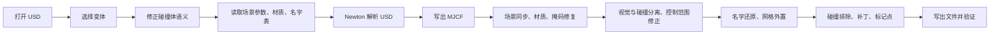

# 转换规则

这篇文档说明产物里的每一项是怎么来的。阅读前建议先看[使用指南](usage.md)。

## 转换流水线



最重要的顺序约束是：所有对 USD 的修改、以及名字表和材质的采集，都必须在 Newton 解析之前完成。解析之后原有的 prim 句柄会失效。

## 变体选择

变体是 USD 自带的合成特性，用来在同一份资产里切换不同配置。资产作者常见做法是把物理参数按引擎分层，例如 `Physics = physx | physics | mujoco | none`。

选择规则按顺序执行：

1. 配置里写了 `usd.variants`，就用配置的值，并检查该值是否存在；
2. 否则使用 USD 里作者指定的默认值；
3. 只有作者没有指定默认值时，才按 `usd.solver_variants` 的顺序在候选值里挑选；
4. 仍然选不到就不选择，并在报告里列出候选值，同时给出警告。

第 3 条存在的原因是：有些资产故意把物理变体留空，由运行时决定。如果不显式选择，组合结果里就读不到 MuJoCo 专用的参数。

报告里的 `variants` 会记录每个变体集合的候选值、本次选择和原因。

## 命名

### 初始名字

Newton 导入 USD 时，用“下划线加 prim 路径”命名实体。例如 joints 下的 `left_joint1` 会变成：

```
_FiveAges_W2_Left_Arm_joints_left_joint1
```

### 还原规则

工具在 Newton 解析之前先建立一张表，记录“下划线名字”到“prim 路径分段”的对应关系，然后按下面的规则还原：

1. 叶子名字在全局唯一时，直接使用叶子名；
2. 叶子名重复时，把路径逐步加长，取能够区分彼此的最短后缀；
3. 加长到极限仍无法区分时，保留原名，并记录到报告的 `naming.kept`；
4. 不在表里的名字是 Newton 自己合成的（例如浮动基座的 `joint_1`），保持不动，并记录到 `naming.unmatched`。

第 2 条会保证对称性：左右两侧同名的部件会一起加长，不会出现一侧用短名、另一侧用长名的情况。

一个常见的现象是关节叫 `left_joint1`，而身体部件叫 `Left_Arm_link1`。原因是 USD 里左右关节本来就不同名，而两侧的身体部件都叫 `link1`，只能靠父层区分。工具只负责补齐唯一性。

改名时会同步更新所有引用，包括执行器、等式约束和接触排除，并检查是否出现重名。

### 用正则改名

标准规则不能满足需求时，用 `patch.rename`：

```json
{
  "patch": {
    "rename": {
      "body": [
        { "pattern": "^Left_Arm_link7_tcp_", "replacement": "left_gripper_" },
        { "pattern": "^Left_Arm_", "replacement": "left_" }
      ],
      "joint": [
        { "pattern": "^joint_1$", "replacement": "base_freejoint" }
      ]
    }
  }
}
```

同一个实体可以写多条规则，按顺序生效。替换文本支持正则反向引用。规则没有命中任何名字时会给出警告。

### 几何命名

几何的名字默认统一成短名：

- 视觉体：`VISUAL_<body>_<序号>`
- 碰撞体：`COLLISION_<body>_<序号>`

例如 `VISUAL_base_footprint_0`、`VISUAL_base_footprint_1`、`COLLISION_base_footprint_0`。序号按同一个 body 和同一类几何各自从 0 开始，顺序与文件中出现的顺序一致，所以多次转换的结果相同。

判断一个几何是视觉体还是碰撞体，依据是碰撞掩码，掩码为 0 时再看名字里是否带碰撞路径。这一步在掩码修复、视觉与碰撞分组和补丁之后执行：一方面要能分清两类几何，另一方面要让 geom 名里的 body 段使用补丁改名后的最终 body 名。

网格（mesh）的名字保持不变，几何上的 `mesh=` 引用也不动。配置里需要暂时保留原路径名时，把 `mjcf.geom_names` 设为 `"usd"`。

补丁里的 `geoms` 规则和 `rename.geom` 看到的是统一命名之前的名字；需要自己控制 geom 名字时，同样把 `mjcf.geom_names` 设为 `"usd"`。

## 执行器

### 为什么产物里是 `<general>`

USD 的执行器参数是以通用的增益和偏置形式保存的，包括增益类型、偏置类型、增益参数和偏置参数。MJCF 里的 `<position>`、`<velocity>` 等写法只是这些通用参数的简写形式。

为了不丢失 USD 里的信息，工具保留 `<general>` 写法。当参数满足位置伺服的组合时，它和 `<position>` 完全等价。

如果确实想改成简写形式，可以用补丁：

```json
{
  "patch": {
    "actuators": [
      { "match": { "joint": "body_joint*" }, "type": "position" }
    ]
  }
}
```

### 控制范围的单位

部分资产把控制范围写成了“度”，而 MJCF 使用弧度。照抄会让控制范围放大 57 倍，策略输出的目标值会落在物理限位之外，表现为关节一直顶住不动。

工具默认会判断控制范围与关节限位的跨度比，接近 180/π 时按度换算成弧度。

### 控制范围缺失

还有一种情况是执行器声明了限幅，但控制范围为空或全零，等于完全没有限制。对位置类执行器，工具会用关节限位补上控制范围并打开限幅。

速度类执行器的控制量是角速度，不做这项处理。

### 执行器命名

Newton 写出的 MJCF 不带执行器名字，而训练框架通常按名字索引执行器。`mjcf.actuator_names` 为 `joint` 时，执行器会用它所驱动的关节名命名；同一个关节有多个执行器时，追加序号区分。

## 几何、碰撞体、材质、时间步

### 几何形状

形状来自 USD：

- USD 里是立方体、球、圆柱、胶囊、圆锥等基本形状时，产物里使用对应的 MuJoCo 几何类型；
- USD 里是网格时，产物里就是网格几何；
- 工具不会把网格替换成基本形状，也不会替 USD 补充缺失的碰撞几何。USD 里没有碰撞体，产物里就没有。

### 网格写出

MuJoCo 的写出接口会把由数组构造的网格写成内联顶点和面片。视觉网格顶点很多时，XML 会膨胀到几十兆甚至上百兆。

默认情况下，工具把每个网格写成 `meshes/` 下的 `.obj` 文件，XML 只保留文件引用。`mjcf.mesh_mode` 设为 `inline` 可以保留内联写法，但超过 `inline_max_vertices` 的网格仍然外置。

### 碰撞体的开关

USD 里可以用 `physics:collisionEnabled` 关闭某个碰撞体，这通常表示“这个部位不参与自碰撞”。对 MuJoCo 来说，关闭就等于完全没有碰撞体。

默认的 `usd.collision_mode = "enable"` 会重新打开这些碰撞体，并在报告里列出全部路径。重新打开后，原本靠碰撞过滤避免的接触会真实发生，需要时用 `mjcf.contact.excludes` 补排除。

另有一种情况：碰撞体自己带了材质信息。Newton 会把这类 prim 当成材质定义，从而整个跳过它的碰撞形状。工具的 `usd.fix_self_material_colliders` 会把材质信息拆到单独的 prim 上，保留碰撞体。

### 碰撞网格的凸包

MuJoCo 只支持凸的碰撞网格，因此碰撞网格会被转成凸包。转换时按 USD 里的近似方式处理：

| USD 中的设置 | 处理方式 |
|---|---|
| `convexHull` | 转成一个凸包 |
| `convexDecomposition` | 拆成多个凸块 |
| `meshSimplification` | 简化网格，保留形状 |
| `boundingSphere` 或 `boundingCube` | 退化成球或包围盒 |

凸包顶点数有上限，默认 64。顶点太少时，凸包会不对称地切掉底面的角，支撑面变小。可以用 `usd.max_hull_vertices` 提高上限。

注意：提高上限只能让凸包更贴近 USD 里写的碰撞网格。如果 USD 里的碰撞网格本身就是低精度模型，底面仍然不会变平。

### 碰撞掩码

MuJoCo 用 `contype` 和 `conaffinity` 决定两个几何是否发生接触。

有些资产把整机自碰撞关掉，Newton 会据此为所有部件生成碰撞过滤。过滤很多时，导出结果可能把每个碰撞体的掩码都算成 0。掩码为 0 表示它不和任何东西碰撞，模型会直接穿过地面。

工具会对照 Newton 模型里真正参与碰撞的几何，把掩码为 0 的碰撞体恢复到正常值。自碰撞排除仍然由 `<contact><exclude>` 表达。

### 视觉体与碰撞体的显示分组

MuJoCo 的几何分组中，第 0 到 2 组默认显示，第 3 组及以后默认不显示。

工具把碰撞体放到第 3 组，并给没有材质信息的碰撞体一个中性灰颜色；视觉体保留在第 0 组。这样打开模型时看到的是视觉网格，需要检查碰撞形状时再打开第 3 组。

判断一个几何是不是碰撞体有两个依据：碰撞掩码不为 0，或者名字里带有 `collisions` 路径。后者用于那些被 USD 禁用、掩码为 0 但本意是碰撞体的几何。

这一步必须在掩码修复之后执行，否则会把掩码为 0 的碰撞体误判成视觉体。

### 接触排除

MuJoCo 的接触排除是按 body 对定义的。工具会把 USD 里的形状级过滤规则推导成 body 级排除：当两个 body 之间所有形状组合都被过滤时，为这两个 body 生成一条排除。

这类过滤来自 USD 的自碰撞开关、形状级过滤对和碰撞组设置。

推导不覆盖的情况需要手工补充，例如物理上必然重叠、但 USD 没有写成过滤规则的部位。配置项是 `mjcf.contact.excludes`。

### 材质与颜色

Newton 写出 MJCF 时不会携带视觉材质，所以颜色由工具单独读取并写入。

颜色来源按优先级依次是：材质的漫反射颜色、常见 PBR 材质的基色、几何自带的显示颜色、贴图文件。带贴图时会把图片复制到产物目录。

读取材质必须遍历实例代理，因为视觉几何经常放在可实例化的容器里；同时必须在 Newton 解析之前完成。

### 时间步与场景参数

Newton 的写出接口不会设置时间步长。如果不补，MuJoCo 会使用默认的 2 毫秒，和 USD 里的设置不一致。

时间步长的来源按优先级依次是：USD 的 MuJoCo 场景设置、USD 的每秒步数设置、配置里的默认值。

其他场景参数（求解器迭代次数、重力、编译选项、开关）也遵循同样的原则：USD 里有就以 USD 为准，没有才用配置。

## 标记点

Newton 的写出接口不会保留 USD 里的 site 和变换标记，TCP、末端执行器中心、相机位置这些常用参考系会丢失。

用 `mjcf.sites` 把它们补回来。site 在补丁之后写入，所以 `body` 写产物里的最终名字。

## 通用补丁

补丁是最后一道处理，用来覆盖前面所有规则无法处理的差异。它可以直接改节点属性、按条件修改元素、重命名、删除元素或插入 XML 片段。

驱动轮这类“必须人为偏离资产设置”的改动适合放在补丁里，因为它在配置中可见、可审查、可版本管理。

规则没有命中任何元素时会给出警告，`strict_patch` 为 `true` 时直接报错。这样可以避免拼错的规则悄悄失效。

## 验证

转换结束后，工具用不带 USD 支持的 pip 版 MuJoCo 编译产物。这一步本身就证明了产物是自包含的。

验证内容：

| 检查 | 内容 |
|---|---|
| 编译 | 加载 XML，确认模型可以被解析 |
| 统计 | 关节、自由度、几何、网格、等式约束、总质量、接触排除数量 |
| 积分器检查 | 计算时间步、阻尼和惯量的比值，判断显式积分是否必然发散 |
| 步进 | 空控制步进若干步，检查 NaN、无穷大和异常速度 |
| 渲染 | 离屏渲染多个视角 |

渲染后端不可用不会导致转换失败，只会给出提示。

## 报告

`<输出>.report.json` 记录了转换过程中的全部判断，主要字段：

| 字段 | 内容 |
|---|---|
| `variants` | 变体集合的候选值、选中值和原因 |
| `scene` | 场景参数的有效值和来源 |
| `collision` | 碰撞体模式、被禁用和重新打开的路径、自带材质修复、凸包顶点上限与覆盖记录 |
| `collisionMasks` | 掩码修复涉及的几何 |
| `visualCollisionSplit` | 视觉体与碰撞体的数量 |
| `geomNames` | 几何统一命名的数量和方式 |
| `materials` | 材质和贴图统计 |
| `meshes` | 网格外置统计 |
| `actuators` | 执行器命名统计 |
| `ctrlrange` | 控制范围修正记录 |
| `contactExcludes` | 新增、跳过和未找到的排除 |
| `sites` | 标记点写入结果 |
| `naming` | 名字还原、加长、保留和未匹配的记录 |
| `changes` | 本次转换的所有改动说明 |
| `warnings` | 需要注意的问题 |
| `config` | 本次实际生效的完整配置 |
